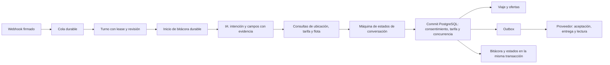

# Decisiones, estados y revisión supervisada del taxi — 28 de octubre de 2026

> **Actualización local 29-10-2026:** [Protocolo de herramientas v3](TAXI_BOT_TOOLS_20261029.md). Sustituye la salida JSON del intérprete por funciones validadas, conservando estas máquinas de estados y el esquema de traza. `promptHash` identifica ahora instrucciones + esquemas + configuración versionada. El prompt sí cambió en esa entrega posterior; las afirmaciones siguientes describen el candidato v2.

**Candidato local v2, sin publicar ni conectar un canal real.** Este trabajo registra decisiones observables; no accede ni pretende guardar razonamiento interno del modelo. No cambió el prompt del intérprete, no entrenó pesos y no ejecutó inferencias externas de pago. Las pruebas del modelo siguen siendo una etapa separada del contrato del servidor.

## Arquitectura aplicada

La IA conserva flexibilidad para interpretar lenguaje natural dentro del contrato de intención/campos. El coordinador decide qué falta y qué consultas puede realizar; la IA no recibe herramientas para reservar, elegir precio, aceptar una oferta ni confirmar por el pasajero. La máquina de estados protege las operaciones; no impone que el cliente dé los datos en un orden fijo.

Se ampliaron las rutas existentes `coordinateTaxi` → `TaxiEngine` → `taxi_bot_commit`; no se añadió un segundo bot ni una segunda base de viajes. No se instalaron frameworks de agentes, colas adicionales ni un proveedor externo de telemetría. El flujo acotado encaja con un servicio cuyos pasos y efectos son conocidos, siguiendo el criterio de empezar con patrones simples y verificables de [Building effective agents, Anthropic](https://www.anthropic.com/research/building-effective-agents).

## Tres máquinas de estados, con responsabilidades distintas

1. **Conversación derivada del estado persistido.** `stateMachine.ts` calcula atención humana, buscando, en camino, pin por aclarar, recogida pendiente, destino pendiente, nombre pendiente, revisión vigente/vencida o lista para revisar. No duplica esos datos en otra columna que pueda desincronizarse. `assertTaxiTransition` comprueba la salida del coordinador: una confirmación exige token vigente y consentimiento actual; cancelación, viaje propio y texto explícito; botones de conductor, acción/UUID correspondientes. Un borrador corregido no conserva el token anterior. PostgreSQL sigue comprobando las condiciones sensibles del commit.
2. **Viaje y ofertas.** El trigger SQL permite sólo transiciones declaradas. Buscando puede pasar a en camino, cancelado o timeout; en camino a completado/cancelado. Una oferta puede aceptarse, rechazarse, vencer o revocarse; una aceptada puede terminarse o revocarse por cancelación. Un estado terminal no se reabre.
3. **Entrega de mensajes.** Pendiente → enviando; después aceptación, entrega, lectura, fallo o incertidumbre según evidencia. Los callbacks pueden llegar antes del ACK HTTP y saltar directamente de enviando a leído. El grafo lo permite y conserva la validación de proveedor/remitente/destinatario. No se convierte aceptación en entrega ni se reenvía automáticamente un resultado incierto.

Los cambios se registran en `taxi_bot_lifecycle_audit`, dentro de la misma transacción. Las rutas antiguas y la APK no deciden estas transiciones.

## Qué queda registrado

`taxi_bot_trace_start` se ejecuta después de reservar el turno y **antes de llamar al modelo o herramientas**. Comprueba evento/lease/revisión, conserva las fuentes y congela la cohorte por contacto. Si el inicio durable falla, el turno no continúa a ciegas; se conserva la recuperación acotada existente de la cola.

Cada intento tiene UUID y clave única `(event_id, lease)`; un nuevo intento no borra el anterior. Contiene:

- Tenant/canal, evento y conjunto de eventos del lote, hashes de fuente, revisión, fechas y estado del intento.
- Versión del motor, modelo solicitado, hash del prompt y fase inicial derivada del servidor.
- Pasos de interpretación, resolución, cotización y candidatas, resultado, código de error, duración y hashes de entrada/salida. Hasta 12 consultas por turno; sin bucle automático de agentes.
- Intención/campos propuestos y, cuando el proveedor los informa, tokens de entrada/salida y hash de su respuesta. Ausencia de uso observado queda `null`, nunca se inventa cero ni un precio monetario.
- Propuesta y motivo de decisión; fase propuesta separada de la fase realmente persistida por SQL.
- Contexto inicial e interpretación validada en contenido privado. Los textos necesarios para revisar se reconstruyen con los eventos originales. No se duplican claves, cabeceras de autenticación, respuestas completas arbitrarias del proveedor ni excepciones con payloads en la telemetría general.

El contexto con nombres, direcciones e historial es **dato privado**, no información anonimizada. El administrador de esa base puede inspeccionarlo; el endpoint agregado no devuelve esos datos. No se envía a un servicio externo de observabilidad. El servidor ya necesitaba mensajes/direcciones para operar; esta entrega no establece una política de borrado para las tablas históricas de eventos o `webhook_queue`.

Estados del intento: `running`, `committed`, `superseded`, `error`, `abandoned`. La terminación del intento se guarda dentro del commit del viaje/outbox. Si se pierde el ACK después del commit, el registro queda `committed`: la llamada posterior de error no puede sobrescribirlo y la reentrega no llama otra vez al modelo. Una corrección nueva conserva `superseded` y el siguiente lote incluye ambas fuentes. Un lease abandonado queda distinguido de un éxito o un rechazo del intérprete.

Los errores capturados por el coordinador pueden terminar en un intento `committed` con paso de interpretación fallido y una aclaración segura al pasajero. Por eso los reportes separan errores del intento, fallos de interpretación y señales de derivación a una persona.

## Revisión y aprendizaje supervisado

Las tablas privadas son `taxi_bot_quality_contacts`, `taxi_bot_quality_cases`, `taxi_bot_quality_reviews` y el secreto de partición. Cada contacto recibe un identificador SHA-256 con sal privada, tenant/canal y teléfono normalizado. No es un identificador público ni una garantía de anonimato para un caso que aún conserva texto.

La cohorte se fija antes de la primera inferencia: buckets 0–6 entrenamiento, 7–8 validación y 9 reserva. Es una partición determinista por contacto, no una promesa de porcentajes exactos de una muestra pequeña. Conversaciones del mismo contacto/canal no cambian de cohorte; el cliente ni el modelo pueden elegirla. Inspeccionar o etiquetar un caso marca el contacto como inspeccionado. La API declara `blindAccuracyMeasured: false`; no hay un evaluador ciego productivo implementado en esta entrega.

Un revisor autorizado etiqueta `correct`, `interpretation_error`, `policy_error`, `external_failure` o `incomplete`. Una interpretación corregida debe corresponder al mensaje literal de origen y pasar el mismo contrato estructurado. Se conserva actor verificado, revisión, fuentes, contexto, expectativa y hashes; el guardado es idempotente con UUID y detecta ediciones concurrentes. Una respuesta del bot no recibe automáticamente etiqueta de verdad.

Sólo casos de entrenamiento, revisados como correctos o errores de interpretación y con expectativa disponible, pueden salir por `training_export`. Validación/reserva e incompletos quedan fuera. La exportación tiene cursor por UUID, máximo 25 casos y presupuesto aproximado de 1 MiB de contenido por respuesta; el indicador `hasMore` permite seguir. Incluye procedencia, revisor, revisiones y hashes de contexto/expectativa. La condición sintética del origen queda desconocida (`null`) cuando no está declarada; recibir un WhatsApp no demuestra que sea un caso real de operación. Contiene texto privado y requiere administración autenticada de la base; no se exporta ni se sube automáticamente a ningún proveedor.

## API privada existente

Todas las acciones llegan al mismo `taxi-bot-admin`. Primero se verifica identidad Traccar, perfil, empresa de taxis y canal. Ninguna acepta un actor elegido por el navegador.

| Acción | Alcance | Contrato adicional |
| --- | --- | --- |
| `quality` | Base autorizada; agregados | `from`, `to`, ventana hasta 31 días |
| `quality_trace` | Sólo administración de la base | `traceId`; contenido privado y marca de inspección |
| `quality_review` | Sólo administración | `traceId`, UUID `requestId`, `revision`, `label`, `expected` opcional según etiqueta |
| `training_export` | Sólo administración | Cursor `after` opcional; sólo entrenamiento revisado |

Son contratos de backend; **no se agregó una nueva pantalla de calidad al panel**. Los agregados se llaman intentos (`attempts`) e intentos de interpretación, no clientes ni conversiones. `handoffSignals` es una señal de revisión; los errores confirmados provienen de las etiquetas humanas. Los estados de proveedor se muestran como transiciones observadas. No se calcula precisión, abandono, tasa de conversión ni costo con denominadores inventados.

RPC revocadas a PUBLIC/anon/authenticated. Tablas privadas con RLS, sin SELECT directo de servicio ni navegador; las RPC SECURITY DEFINER exponen sólo el contrato necesario. El servidor conserva su llave de servicio, nunca se entrega al panel.

## Crecimiento y retención

La bitácora se agrupa en memoria durante las consultas y se guarda con el commit; no hace una petición HTTP a la DB por cada token o paso. Hay una RPC de inicio adicional por intento. No se midió la latencia o capacidad bajo carga real, por lo que no se promete un volumen de producción.

Índices por tenant/canal/fecha, intento pendiente, revisiones y retención. La rutina existente de mantenimiento llama al mantenimiento nuevo, con límites por ejecución:

- Hasta 100 intentos abiertos de más de tres minutos pasan a `abandoned`.
- Hasta 200 trazas de más de 30 días se eliminan.
- Hasta 500 cambios de ciclo de vida de más de 90 días se eliminan.
- Hasta 100 casos revisados y 100 entradas de revisión de más de 90 días se eliminan.

Un caso revisado conserva su propia instantánea hasta su retención aunque se retire la traza de origen. Los identificadores con sal/cohortes se conservan para evitar que un contacto reaparezca en otra partición. Estos límites aplican a las tablas nuevas; no eliminan pedidos/viajes ni fuentes históricas existentes. En una publicación real debe revisarse esta política con el responsable de datos.

## Pruebas y límites de evidencia

Runner reproducible: `estrella-taxis-backend/scripts/test-taxi-bot.ps1`.

- Matriz sintética de **4,681 pruebas**: 4,608 combinaciones de campos/control/viaje/mensaje/tarifa/consentimiento, 20 propuestas peligrosas y 53 comprobaciones de estados terminales. Llama al coordinador y a sus guardas con respuestas de intérprete declaradas explícitamente.
- Pruebas de hashes/versiones, uso observado, salida inválida del modelo, ausencia de persistencia, límite de consultas y errores sin payloads en el log.
- PostgreSQL/PGlite real local: atomicidad, replay, pérdida de respuesta después del commit, intentos distintos, fuente reemplazada, RLS/tenant, etiquetado/revisión concurrente, cohortes, retención y presupuesto de exportación.
- Comparación de 128 pares de ciclo de vida y 192 estados derivados SQL/TypeScript, dentro de los casos SQL. Esos subcasos no se suman otra vez al contador total.
- Gate ampliado a 34 fuentes/pruebas: sin `any`, conversiones dobles ni supresiones. Entrypoints Deno y TypeScript estricto incluidos.

Los miles de pruebas no son miles de inferencias reales, frases de clientes ni una medida de comprensión del modelo. Son evidencia de contratos y transiciones. Los fixtures sintéticos conocidos son regresiones, no prueba ciega. El prompt del intérprete se conservó; no hay entrenamiento autónomo ni modificación de pesos. El evaluador acotado existente continúa separado y no se ejecutó contra una cuenta real aquí.

Evidencia previa relevante: `taxi-trace-existing-sql.log` preserva un fallo de un fixture antiguo que intentaba pasar un mensaje leído a enviando. El grafo correcto lo rechazó. Se ajustó el escenario para crear un segundo mensaje por la ruta normal, reclamarlo y vencer su lease; se reforzó que el primero siga leído y sólo el segundo quede incierto. No se abrió el grafo para admitir una regresión de entrega.

Resultado final y hashes: `TAXI_BOT_TRACE_STATE_EVIDENCE_20261028.json`; log `taxi-observability-final.log`. La integración final tiene 4,779 pruebas Deno y 43 casos PostgreSQL/integración: **4,822 aprobados**, sin contar dos veces los subcasos.

## Publicación pendiente y siguientes decisiones

Las cuatro migraciones candidatas, en orden, son `20261027220000`, `20261027223402`, `20261028145826` y `20261028160342`. No activar el consumidor entre ellas ni publicar sólo el nuevo `engine.ts`: el protocolo v2 exige el inicio durable de traza. Comparar primero esquema/fuentes activos, respaldar y ensayar el conjunto. No se modificó la base remota, no hubo GitHub/VPS/APK ni WhatsApps/viajes reales.

La pestaña **Calidad** ya está implementada localmente en `/taxi-bot`, con las mismas acciones del servidor. La vista `/taxi-bot-diseno` permite recorrer sus controles con un caso inventado; no usa mensajes reales ni guarda revisiones remotas. La captura visual nueva está pendiente: el navegador fue rechazado por la política automática de URL. No se eludió ese rechazo por otros navegadores o herramientas.

Después de validar y publicar el conjunto: evaluación acotada con el modelo elegido, mensajes reales de la base autorizados para revisión y un viaje de prueba con teléfonos propios. Cambios de prompt sólo tras encontrar una discrepancia reproducible y preservar una cohorte prospectiva sin usar para ajustarlo.

El chequeo de espacios Git conserva cuatro saltos Markdown con espacios del documento arquitectónico histórico; no se reformateó ese historial para ocultar el aviso. El diff de `taxi_bot_commit` respecto al candidato anterior añade sólo las cuatro líneas de guardas/cierre de traza; se conserva la lógica de negocio existente.

## Panel de calidad añadido en esta continuación

- `src/components/TaxiQualityPanel.tsx` y su CSS extienden el panel existente; `src/lib/taxiQualityClient.ts` usa el cliente autenticado de tracking. `qualityContracts.ts` valida las respuestas externas como `unknown`, con límites de mensajes, historial, pasos y paginación.
- Operadores: sólo agregados del tenant/canal autorizado. Administración: lista de intentos y lectura/revisión privada. Tanto el handler como las RPC mantienen el alcance de base y canal; el navegador no aporta el identificador del revisor.
- Filtro explícito de hasta 31 días. Se indica el periodo realmente consultado y el horario de la computadora. Los intentos se cuentan por inicio y las revisiones por fecha de revisión: los contadores no se convierten en una tasa de precisión.
- `quality_attempts` llama a `taxi_bot_quality_read(...,'attempts',...)`. Recupera 20 intentos por página, con una fila adicional para `hasMore`; orden descendente por `(started_at,id)`. El cursor conserva los microsegundos originales de PostgreSQL. La lista no incluye textos, teléfonos ni particiones de contacto y no marca el contacto como inspeccionado. Memoria de pantalla acotada a 100 intentos.
- Abrir un caso sí marca primero el contacto inspeccionado. Se muestran los mensajes actuales, contexto anterior, propuesta validada, consultas y resultado real del servidor; no se muestra razonamiento privado del modelo. El resultado propuesto nunca se presenta como estado confirmado.
- Para etiquetar hay que elegir explícitamente una categoría. Un error de interpretación requiere intención, campos y citas literales; la misma validación del intérprete rechaza datos inventados y citas que contradigan una corrección posterior. Un intento en proceso no se revisa. La revisión existente devuelve también su interpretación esperada, evitando reemplazarla silenciosamente por la propuesta original al reabrir.
- El guardado usa UUID de solicitud y revisión del caso. Ante transporte incierto se conserva el mismo comando; se bloquean base/canal/pestañas y se ofrece «Comprobar revisión». Errores definitivos/conflictos exigen recargar el caso. El comando pendiente se conserva en memoria de la vista y hay aviso al cerrar/recargar; no se promete recuperación del formulario después de cerrar la pestaña ni se guarda el contenido privado en almacenamiento local. La revisión durable del servidor sigue siendo idempotente.
- Etiquetar no modifica instrucciones, pesos ni partición del contacto. La exportación de entrenamiento sigue limitada a casos revisados de `train`; no se añade un botón de exportación masiva de mensajes al panel.
- Verificación final ampliada: **4,782 pruebas Deno + 45 casos PostgreSQL/PGlite = 4,827 aprobados**; tipado estricto y gate de 37 archivos. Build de Vite aprobado, con avisos previos de tamaño del bundle global y de importación de Maps. Lint de los archivos nuevos: sin avisos ni errores. Detector de diseño: `[]`. Estas verificaciones no sustituyen las capturas pendientes ni una prueba con el modelo o WhatsApp real.

Log actual: `.codex-tmp/taxi-quality-panel-tests.log`. Build: `.codex-tmp/taxi-quality-panel-build.log`. Servidor local comprobado en `http://127.0.0.1:5290/taxi-bot-diseno` (HTTP 200). No se aplicaron las migraciones a una base remota.
